<p align="center">
  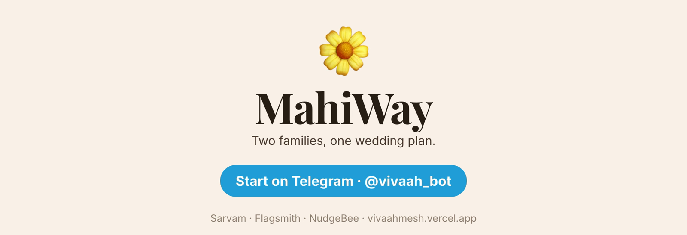
</p>

<h1 align="center">MahiWay</h1>

<p align="center">
  <b>One wedding plan for two families, in every family's own language.</b><br>
  An always-on planning agent listens to the family groups, calls the venue, and never commits anything without the right person.<br>
</p>

<p align="center">
  <a href="https://vivaahmesh.vercel.app">Live site</a> ·
  <a href="https://t.me/vivaah_bot">Telegram @vivaah_bot</a> ·
  <a href="https://github.com/perfect7613/VivaahMesh/issues/1">PRD</a> ·
  <a href="./DESIGN.md">Design principles</a> ·
  <a href="docs/TESTING.md">How to test</a>
</p>

<p align="center">
  Built at <b>FestiveHacks × WeAreDevelopers Conference India</b> (25 Nov 2026) with
  <b>Sarvam AI</b>, <b>Flagsmith</b> and <b>NudgeBee</b>.
</p>

<p align="center">
  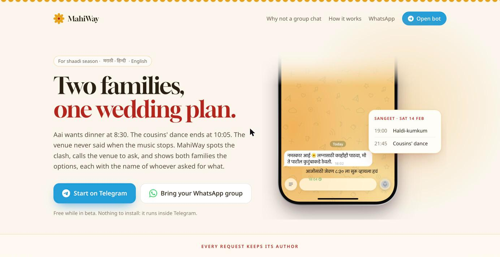
</p>

## Why not just a WhatsApp group?

A WhatsApp group is where the plan gets *discussed*. It isn't the plan. Aai's "dinner by 8, the elders can't wait" is buried under 200 messages. The venue's "music till 10" is a voice note one cousin heard. Nobody knows which version is current, and one family's private worries leak to the other.

MahiWay keeps the groups and adds what they can't do:

| | Family WhatsApp/Telegram group | MahiWay |
|---|---|---|
| Who said what | Scrolls away | Every wish is a note credited to the person, private to their family unless they share it |
| Vendor terms | "I think he said 10" | The venue is called (Sarvam), and the answer is stored as evidence, word for word |
| Conflicts | Found on the day | The compiler checks the timeline against every confirmed fact and ranks options |
| Decisions | Whoever shouts last | Each family responds, and the couple approves one exact plan revision. An approval made on an outdated screen is rejected |
| Language | Everyone reads Hinglish | Each person reads in their own language (22 Indian languages + English) |

## Screenshots

| Talk to the bot | Who asked for what | Always-on agent | Planner |
|---|---|---|---|
| 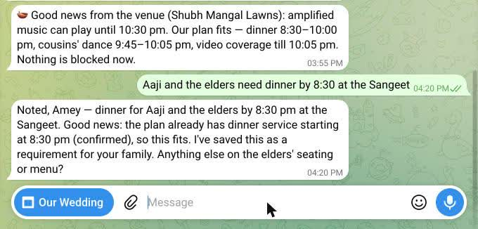 | 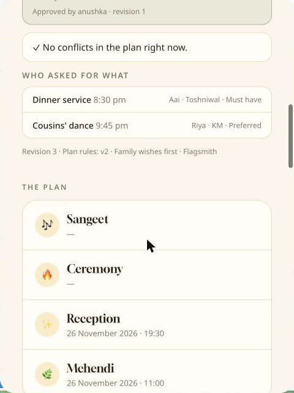 | 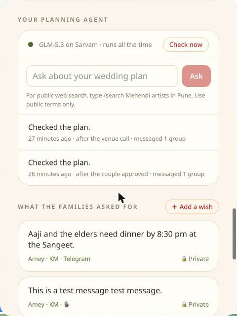 | 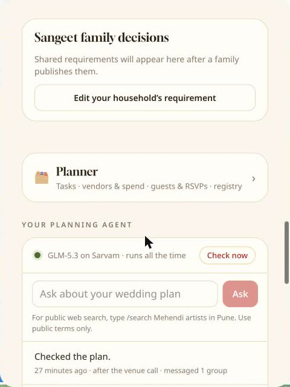 |

| The family group vs the plan | Flagsmith flags (Production) | NudgeBee recovery workflow |
|---|---|---|
| 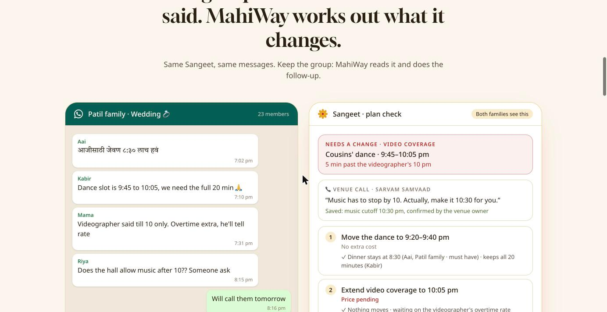 | 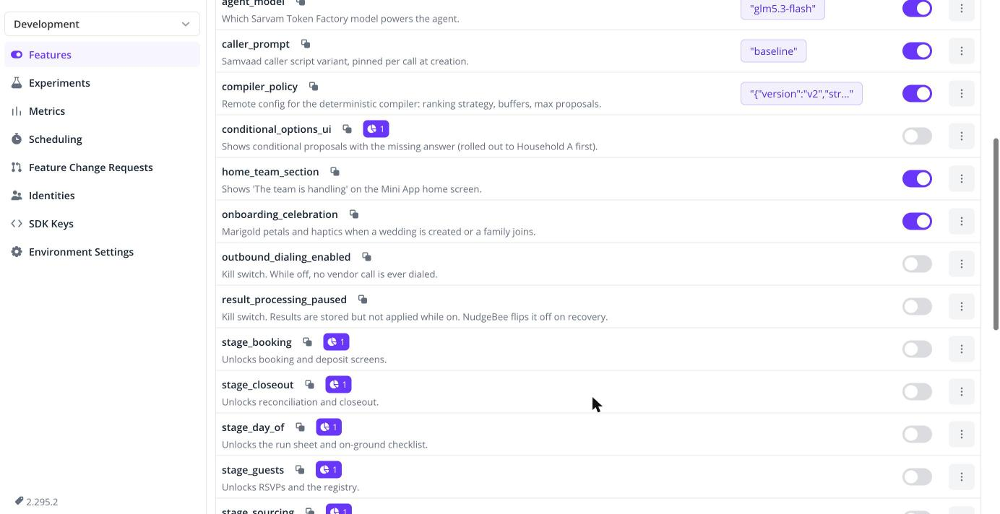 | 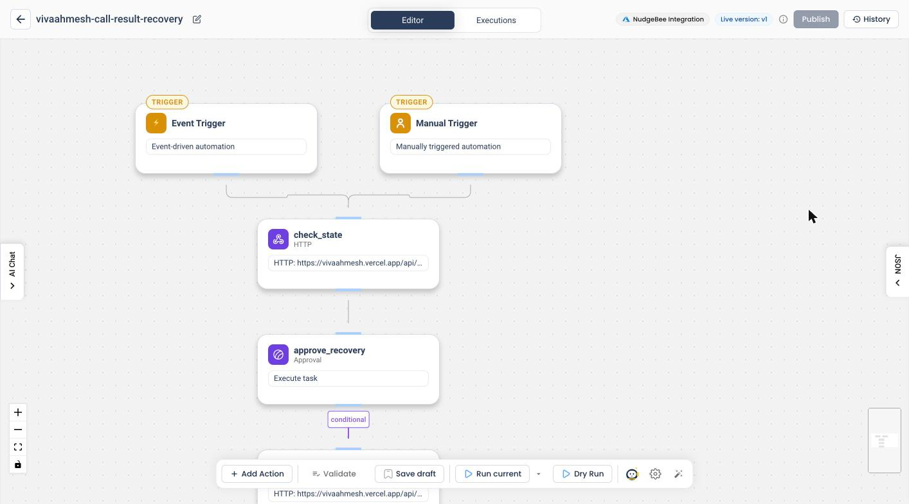 |

### Worked example: the Sangeet

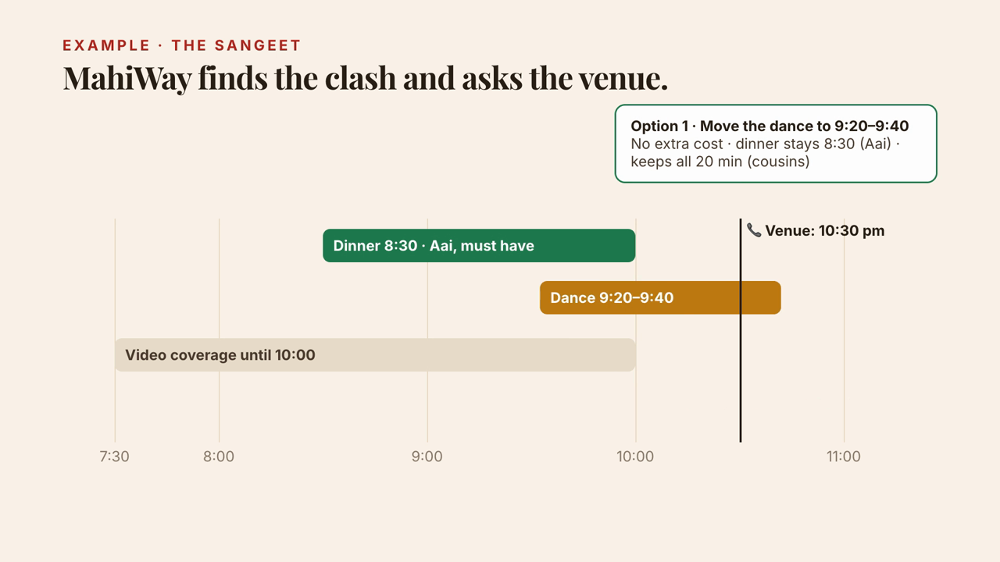

Aai needs dinner at 8:30. The cousins' dance runs 9:45–10:05, five minutes past the videographer's 10:00. Nobody knows when the hall stops the music. MahiWay flags the overrun, asks the venue (10:30), and offers "move the dance to 9:20–9:40": no extra cost, dinner unchanged, all 20 minutes kept. Each household responds and the couple approves that exact revision.

## How it works

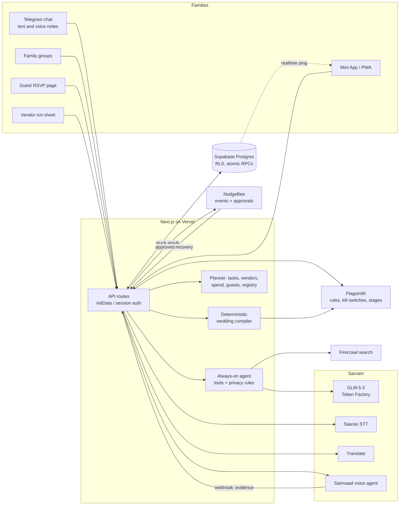

### From a wish to an approved plan

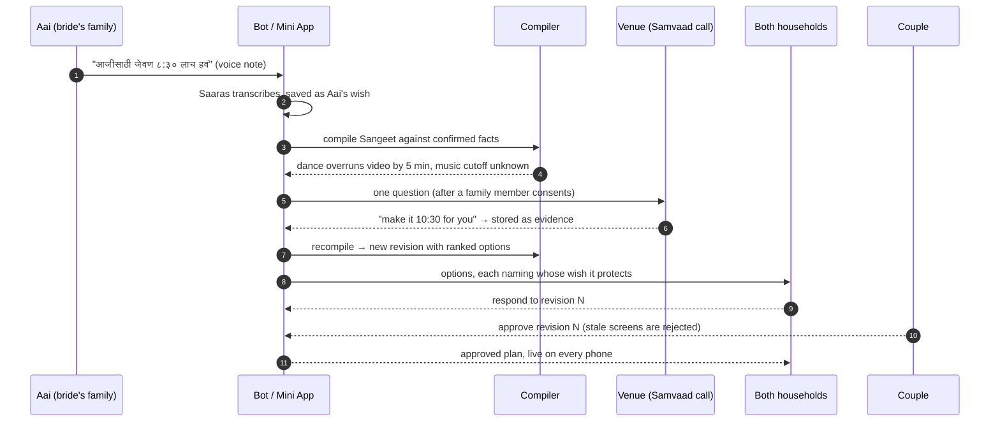

### Recovery when call results get stuck

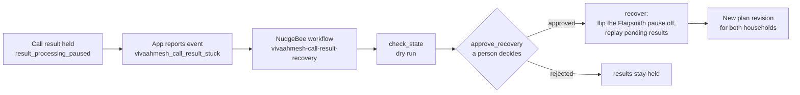

### Wedding stages (Flagsmith-gated)

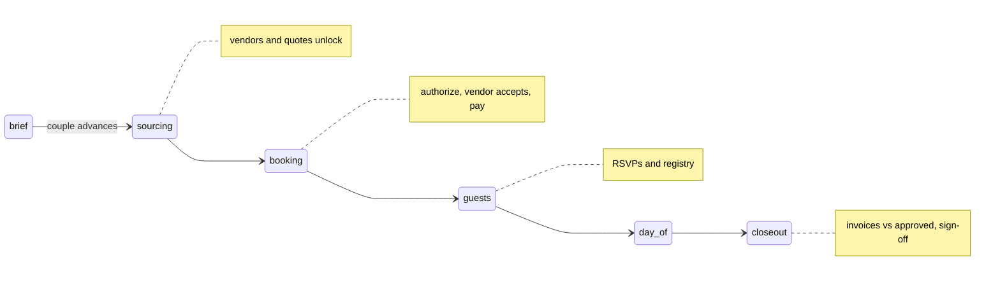

## What it does

| Area | Capability | How it works |
|---|---|---|
| **Families** | Telegram bot + Mini App (also a PWA): create a wedding, invite the other family, pick any of the **22 scheduled Indian languages or English** | Marathi, Hindi and English are hand-written. Every other language is translated once by GLM-5.3 and cached. Urdu, Kashmiri and Sindhi display right to left |
| | **Functions in the family's own words**: Haldi, Sangeet, Pheras, plus anything they add (Tilak, Jaggo, Nikah…) | Each function has its date, time, venue and notes |
| | **Voice first**: voice notes in any language, household dictation, spoken recap | Sarvam **Saaras** transcribes, **Dictate** for Marathi household input, **Bulbul** reads the approved plan aloud |
| **Always-on agent** (GLM-5.3 on Sarvam Token Factory) | Wakes on every message, voice note, family-group update, call result and approval | Plus a heartbeat every 5 minutes (GitHub Actions) |
| | **Reads the family groups** once the couple or an authorized parent links one | Saves real updates as private household notes credited to the speaker. Mentions get a reply based on recent group messages |
| | **Ask about your plan** in a Telegram DM or the app; `/search` for vendor ideas, prices, muhurat dates or customs | Cites public search results and can read a result through Firecrawl. Chat history is scoped to the wedding and member |
| | **Privacy and limits** | Private conversations stay in their own chat; notifications use shared plan context. Up to 3 notifications per automatic run, one nudge per audience per hour, 20 interactive requests per account per 24 h (scheduled checks don't count) |
| **The plan** | **Deterministic wedding compiler** checks activities against confirmed facts (music cutoff, photographer coverage, makeup readiness…) and ranks options | Typed vendor terms stay *conditional* until the vendor confirms them |
| | **Revision-bound decisions**: each household responds to an exact revision, and the couple approves one | Late evidence creates a new revision, so a tap on an outdated screen changes nothing |
| | **Venue call**: a parent authorizes it and the agent asks the venue for the music cutoff | Sarvam Samvaad outbound. Mid-call corrections are kept and the last answer wins. Browser voice fallback with per-call consent, and a makeup-artist enquiry by link. Until a Sarvam number is connected, **rehearsal mode** runs a simulated venue through the same pipeline, labelled "Rehearsal" everywhere |
| **The planner** | **Owned tasks** with due dates | Deliverables like the wedding film stay open after the wedding; the couple signs off at closeout |
| | **Vendors**: the family's own beside sourced ones | Authorizing, vendor accepting and paying are three separate steps. Only the couple, or a parent they granted access, can authorize |
| | **Spend**: planned, committed and actual | An invoice that differs from the approved amount raises a warning and an owned task. Only the couple sees money |
| | **Guests and registry** | RSVPs per function with meal counts on a guest link (no Telegram needed); two guests can never reserve the same gift |
| | **Vendor run sheet** | Each vendor gets a link with only their functions and times from the approved plan |
| | **Stages and live updates** | Screens unlock stage by stage through Flagsmith; other phones refresh within about two seconds of any change |

## Sponsors

Each of the three sponsors does a job MahiWay can't work without:

| | Job in MahiWay | Without it |
|---|---|---|
| **Sarvam AI** | Hears, speaks and thinks in the families' languages: the agent's brain, every voice note, every translated screen, the venue call | Aai's Marathi voice note is just audio, and the venue never gets asked |
| **Flagsmith** | Holds the rules: how the plan is ranked, which screens are open at each stage, and the switches that stop calls in seconds | Every rule change is a redeploy, and nothing can be stopped quickly |
| **NudgeBee** | Watches the call pipeline and brings a person in before stuck results are replayed | A stuck result silently leaves both families on an old plan |

### Sarvam AI: the voice and brain of the wedding

One Sarvam key covers five models:

| Model | What it does in MahiWay | API |
|---|---|---|
| **GLM-5.3** (Token Factory) | Runs the always-on agent with real tool calling: reads family groups, saves notes under the right person, answers questions, decides who to nudge. Also translates the interface into the 20 languages we don't hand-write | `POST /v2/chat/completions`, model `glm5.3-flash` (switchable to `glm5.3` from Flagsmith) |
| **Saaras v4** | Turns a voice note in Marathi, Hindi or Hinglish into text, so elders can speak instead of type | `speech-to-text` |
| **Sarvam Translate** | Sends every bot and agent message in the reader's language: 22 Indian languages plus English | `sarvam-translate:v1` |
| **Samvaad** | A voice agent that phones the venue, asks one precise question, and returns structured answers (`music_cutoff`, `confirmed`, `vendor_wording`) that go into the plan as evidence | Outbound API + webhook ([`docs/samvaad-agent.md`](docs/samvaad-agent.md)) |
| **Bulbul**, **Dictate** | Reads the approved plan aloud; lets a household speak its requirements | Bulbul TTS, Dictate |

### Flagsmith: the control plane (project `MahiWay`, Development + Production)

| Capability | How MahiWay uses it |
|---|---|
| **Remote config drives the compiler** | `compiler_policy` is a versioned JSON policy deciding how options are ranked. Change it in the dashboard and the next plan uses it, no deploy. Every revision and approval records the policy version |
| **Kill switches with safe defaults** | One toggle stops every outbound call; another holds call results without losing them. If Flagsmith is unreachable: dialing off, agent on |
| **Segments and identities** | Marathi speakers get the Bulbul recap, one household gets features first, each wedding's stage unlocks screens. Shared decisions use one wedding-level identity, so both families see the same rules |
| **Experiments** | `caller_prompt` A/B tests how the voice agent asks the venue, bucketed per call |
| **Live model switching** | `agent_model` swaps the GLM model mid-event |

| Flag | What it controls |
|---|---|
| `compiler_policy` (JSON) | Ranking strategy (`preserve_family_priorities` / `minimize_changes` / `lowest_confirmed_cost`), buffers, max options, dance during dinner. Every revision and approval stores the policy version it used |
| `caller_prompt` | Venue-call question variant (A/B, bucketed per call) |
| `voice_channel` | Phone or browser voice |
| `outbound_dialing_enabled` | Kill switch: no real call without it |
| `result_processing_paused` | Kill switch: store call results but don't apply them (NudgeBee recovery flips it back) |
| `agent_enabled`, `agent_model` | Turn the agent off, or switch GLM model live |
| `voice_recap_bulbul`, `conditional_options_ui`, `whatsapp_bridge_enabled`, `onboarding_celebration`, `home_team_section` | Per-segment UI rollouts |
| `stage_sourcing` … `stage_closeout` | Stage gating |

| Segment / identity | Used for |
|---|---|
| `marathi_speakers` (language = mr) | Bulbul recap |
| `household_a` | Conditional options + WhatsApp bridge |
| `stage_*_plus` (wedding_stage) | Stage gating |
| `wedding:<id>:member:<id>` | Per-person UI |
| `wedding:<id>` | Anything both families must see identically (the compiler policy) |

Create everything with `node web/scripts/flagsmith-setup.mjs`. Flip a flag live with `node web/scripts/flag.mjs <flag> on|off|key=value`.

<details>
<summary><b>Caller-prompt experiment</b> (scripted replay and publishing to Flagsmith)</summary>

Caller-prompt experiment (5 scripted scenarios × 2 variants, observed counts, not a statistical claim): [`docs/caller-experiment.md`](docs/caller-experiment.md), reproduce with `cd web && npm run experiment`.

To publish the ten scripted calls, use a dedicated Flagsmith replay environment with a connected warehouse and a running `caller_prompt` experiment. Use the flag's own value `baseline` as control. Give the `clarify_scope` variation a key, including on existing projects, and set a 50/50 experiment split. Define Sum metrics on `caller_facts_confirmed`, `caller_follow_up_count` and `caller_unsupported_changes`. With its environment key in `FLAGSMITH_EXPERIMENT_REPLAY_KEY`, run `npm run experiment:publish -- <unique-run-id>` from `web/`. A complete run reports 10 exposed identities and 40 accepted events. Use a fresh run ID for each independent sample. After a timeout, check intake before repeating, since the warehouse may already have received events.

Live exposures use a pinned call identity and are recorded when Sarvam accepts an outbound attempt or issues a consented browser session. Completed results report observed confirmations and follow-up counts, including zeros for unanswered calls. Unsupported changes require known ground truth and are scored in the scripted replay. The event payload contains counts and experiment metadata. [Flagsmith experiment setup](https://docs.flagsmith.com/experimentation/run-an-experiment)

</details>

### NudgeBee: incident and approval-gated recovery

| Step | What happens |
|---|---|
| 1. Detect | A venue answer is stuck (or the agent fails): the app raises a NudgeBee event |
| 2. Dry run | Workflow `vivaahmesh-call-result-recovery` runs `check_state` to see what would recover |
| 3. Approve | `approve_recovery` waits for a person. Nothing reaches the plan without that approval |
| 4. Recover | `recover` turns the Flagsmith pause off and replays the held results |
| 5. Result | Both households read the new plan revision; every step is in NudgeBee's executions log |

<details>
<summary><b>Azure result worker and inline deployments</b></summary>

The Azure worker leases saved vendor answers from Postgres. A stopped worker leaves answers available for recovery. An independent NudgeBee scan reports overdue results, keyed by the provider result ID, and requests an investigation. Human approval turns off the Flagsmith pause switch, restores the worker and replays the identified call. Both households read the resulting plan revision. [Azure worker setup](docs/result-worker.md) · [NudgeBee workflows and rehearsal](docs/nudgebee-workflows.md)

Existing inline deployments can keep their API-key incident reporting, agent-failure alerts and approved recovery endpoint. The Azure workflows use a separate integration webhook.

</details>

## Test it

| What | Command | Covers |
|---|---|---|
| Unit tests | `cd web && npm test` | Compiler, flags, lifecycle, experiment, security (142 tests) |
| Live end to end | `node web/scripts/e2e-live.mjs <url>` | Families → call → approval → agent, with signed Telegram users and a throwaway wedding |
| Live planner | `node web/scripts/e2e-lifecycle.mjs <url>` | Stages, vendors, spend, guests, RSVPs, registry race, vendor run sheet |
| By hand, with real phones | [`docs/TESTING.md`](docs/TESTING.md) | Step-by-step script with what you should see |

<details>
<summary><b>Seed a rehearsal wedding</b></summary>

With the migrations applied to your rehearsal project, set `NEXT_PUBLIC_SUPABASE_URL`, `SUPABASE_SERVICE_ROLE_KEY` and `TELEGRAM_BOT_USERNAME` in the server environment. From `web/` run `npm run seed:wedding -- <organizer-telegram-id>` using Node 22. The organizer is the first partner. Share each of the two household links with its family and the single-use couple invitation with the other partner. These private links grant access and should stay out of build logs.

The seed creates a fictional ₹15 lakh, 350-guest wedding with Sangeet, Ceremony and Reception. Open the Sangeet plan to see the five-minute video overrun and unresolved venue cutoff. Rerunning for the same organizer returns the same wedding and preserves subsequent edits. Seeded weddings use a simulated venue even when Sarvam and a real phone number are configured. The outbound Flagsmith switch still controls whether the rehearsal can start. The simulated answer updates the plan with a rehearsal label and stays in the app. To deliberately exercise the live phone or browser path with a consenting participant, set `DEMO_SEEDED_LIVE_CALLS=1` on the app server and configure the relevant channel. Clear the setting when the session ends.

</details>

## Setup from a fresh checkout

Prerequisites: Node 20.9+, the Supabase CLI, the Vercel CLI, and a Telegram bot from @BotFather (`/setprivacy` → **Disable**, so it can read family groups).

```bash
git clone https://github.com/perfect7613/VivaahMesh && cd VivaahMesh
supabase link --project-ref <ref> && supabase db push      # schema + RPCs
cd web && cp .env.example .env.local                        # fill in (table below)
npm install && npm test                                     # 142 tests
npm run dev                                                 # http://localhost:3000/tg (DEV_AUTH_BYPASS=1 for a browser)
node scripts/flagsmith-setup.mjs                            # flags + segments
vercel deploy --prod                                        # then set the same env on Vercel
curl -X POST "$APP_URL/api/telegram/setup" -H "x-setup-secret: $TELEGRAM_WEBHOOK_SECRET"
# For the Azure result worker and NudgeBee automation, follow docs/result-worker.md.
gh secret set OPS_SECRET                                    # heartbeat workflow (.github/workflows/heartbeat.yml)
```

| Env | For |
|---|---|
| `NEXT_PUBLIC_SUPABASE_URL`, `NEXT_PUBLIC_SUPABASE_ANON_KEY`, `SUPABASE_SERVICE_ROLE_KEY` | Database (service key server-only) |
| `TELEGRAM_BOT_TOKEN`, `TELEGRAM_BOT_USERNAME`, `TELEGRAM_WEBHOOK_SECRET`, `APP_URL` | Bot + Mini App |
| `BROWSER_AUTH_SECRET`, optional `TELEGRAM_LOGIN_CLIENT_ID` | Browser PWA sign-in |
| `SARVAM_API_KEY` | Token Factory (GLM), STT, Translate, Bulbul |
| `SARVAM_VOICE_API_KEY`, `SARVAM_ORG_ID`, `SARVAM_WORKSPACE_ID`, `SARVAM_APP_ID`, `SARVAM_APP_VERSION`, `SARVAM_CONNECTION_ID`, `SARVAM_AGENT_PHONE`, `DEMO_VENUE_PHONE` | Samvaad outbound call (only people who consented are ever called) |
| `DEMO_REHEARSAL_CALLS=1` | Simulated, labelled venue answer until a number is connected |
| `CALLS_WEBHOOK_SECRET` (32+ chars) | Per-call webhook tokens, dictation drafts |
| `FLAGSMITH_SERVER_KEY`, `FLAGSMITH_ADMIN_API_KEY` | Flag evaluation; admin key for setup and recovery |
| `FIRECRAWL_API_KEY` | Agent web search + page reading |
| `WEDDING_REALTIME_SECRET` | Optional server secret of at least 32 characters for rotating realtime topics independently. |
| `NUDGEBEE_API_KEY`, `NUDGEBEE_ACCOUNT_ID` | API-based ops events and cluster selection |
| `CALL_RESULT_PROCESSOR`, `NUDGEBEE_EVENT_WEBHOOK_URL` | Azure result worker mode and incident workflow |
| `OPS_SECRET` | Heartbeat, replay and recovery endpoints |

<details>
<summary><b>Browser sign-in at <code>/tg</code></b></summary>


1. Apply the Supabase migrations and set `APP_URL` to the canonical HTTPS origin. Set `BROWSER_AUTH_SECRET` to a separate random value from `openssl rand -hex 32`.
2. In BotFather, select the same bot used by the Mini App, open **Login Widget**, and add the origin to **Allowed URLs**. Keep the default RS256 signing algorithm. If the configured Client ID differs from the bot token’s numeric prefix, set `TELEGRAM_LOGIN_CLIENT_ID` to the ID displayed by BotFather.
3. In Supabase Auth, enable the email provider, allow new signups, and add the exact `<APP_URL>/api/browser-auth/email` redirect URL. Keep the email templates’ `{{ .ConfirmationURL }}` links and configure SMTP for delivery to family members. Open each link in the browser that requested it.

The browser saves the most recent wedding schedule on the device for up to 24 hours. Signing out or switching accounts clears that copy. See the [browser PWA test steps](docs/TESTING.md#browser-pwa).

</details>

## Security model

| Area | Protection |
|---|---|
| Keys | The browser never sees a server key |
| Sign-in | Wedding APIs authenticate Telegram `initData` or a signed browser session issued after Telegram Login or Supabase Auth |
| Webhooks | The bot webhook checks Telegram's secret header; each Sarvam callback carries a per-call HMAC token |
| Database | RLS on every table with no anon policies |
| Private data | Budgets are couple-only. Household-private notes are loaded only into that household's direct-chat context. The shared activity feed holds status and delivery counts |
| Web search | Only the terms typed after `/search` go to the provider. Search runs get no wedding data or chat history, and Firecrawl reads are limited to results from the same search |

## Repo layout

| Path | What's there |
|---|---|
| `web/src/app/tg` | Telegram Mini App |
| `web/src/app/api/*` | JSON API, bot + Sarvam webhooks, agent, ops endpoints |
| `web/src/lib/compiler` | Pure wedding compiler + tests |
| `web/src/lib/server/agent.ts` | Always-on GLM agent (tools, privacy rules, heartbeat, family groups) |
| `web/src/lib/server/*` | Sarvam, Flagsmith, NudgeBee, Firecrawl, plan, calls, translate, lifecycle |
| `web/scripts` | flagsmith-setup, flag, nudgebee-setup, e2e-live, e2e-lifecycle |
| `supabase/migrations` | Schema and atomic RPCs (record_revision, approve_revision, apply_call_evidence…) |

## Team

Built by the MahiWay team: @perfect7613, @guglxni and @ghoshvidip26. Teammates' pull requests (#20–#23: revision approvals, Marathi voice input and Bulbul recap, browser voice fallback, call corrections and makeup replies) were reviewed and merged into `main`.

## AI assistance disclosure

As the hackathon rules require: this project was built with the help of AI coding assistants (Claude Code). Inside the product, GLM-5.3 (via Sarvam) runs the planning agent and the UI translation, and the Sarvam models handle speech, translation and voice. Each AI-written message is labelled as coming from the planning agent. The team reviewed the code and can explain everything submitted.
